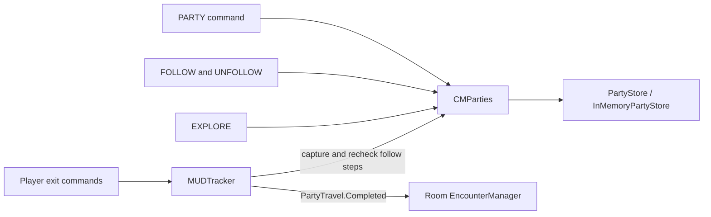

# Party management and exploration

Epic 1 lets players stay in a party while exploring together or separately. Party membership, following, and encounter participation are separate relationships.

This implementation uses the encounter-initiation snapshot at `68a3a2e75f`. The integration limits and newer branch dependencies are listed below. They need to remain visible when reviewing or closing [Epic 1](https://github.com/SWEN-783-MUD/CoffeeMud/issues/29).

## Player commands

`PARTY HELP` lists commands by purpose. `HELP PARTY`, `HELP FOLLOW`, `HELP UNFOLLOW`, and `HELP EXPLORE` explain their behavior.

| Command | Behavior |
|---|---|
| `PARTY` | Show the leader, member count, and roster, with the reader marked as "you". |
| `PARTY CREATE` / `PARTY LEAVE` | Create or leave a party. The earliest remaining member takes over when the leader leaves. |
| `PARTY INVITE <name>` | The leader invites an online character, including someone in another room. |
| `PARTY REQUEST <leader>` | Ask to join an online leader's party. |
| `PARTY PENDING` | Show invitations, requests, expiry, and the available commands. |
| `PARTY ACCEPT <name or id>` | Accept an invitation by its original sender's exact name or its ID. |
| `PARTY APPROVE <name or id>` | The current leader approves a request by the candidate's exact name or its ID. |
| `PARTY DECLINE <id>` / `PARTY CANCEL <id>` | Decline an incoming invitation or request, or withdraw an outgoing one the player controls. |
| `PARTY LEADER <name>` | Pass leadership to a current member, including an offline member. |
| `FOLLOW <name>` / `UNFOLLOW` | Follow an eligible party member in the same room, or stop following without leaving the party. |
| `EXPLORE`, `EXPLORE NORMAL`, `EXPLORE AVOID NOTICE` | Inspect or select the player's own exploration activity. |

Name selectors match full character names without regard to capitalization. They resolve stored invitations and requests, so the other character can be offline after the entry was created. A name that matches multiple invitations shows ID choices and does not join either party. Decline and cancel continue to use IDs.

Creating or joining a party does not move anyone or establish follow links. Party leadership does not select the movement leader. Multiple players can follow one member directly, and follow chains are also supported.

## Milestone rules

- Parties contain player characters only, with one party per character.
- Membership and pending state last for the server run. Reconnecting preserves membership. Restarting clears it.
- `PARTYMAXMEMBERS` defaults to 6, including the leader and disconnected members. `PARTYINVITESECONDS` defaults to 120 and applies to invitations and requests. Both settings belong in the server's active INI file.
- Pending entries reserve no seats. Acceptance and approval recheck membership, authority, expiry, and capacity together.
- Duplicate or crossed invitation/request commands keep the first entry, action, ID, and deadline.
- Changing leaders preserves member order and pending entries. The current leader owns approval and outgoing invitation cancellation.
- A saved rename moves party state to the new character key. Successful deletion retires character-specific state so reusing the name starts fresh.
- Disconnecting or leaving clears direct player party-follow links involving that character. Descendants keep their own links. Reconnecting does not restore old links.
- A blocked follower stays behind, detaches from the parent who moved, and receives an explanation. Its descendants stay with it. Other branches can finish.
- A successful independent room move drops the mover's outgoing player follow link. A failed move preserves it.
- Player-to-player following keeps CoffeeMud's native refusal, visibility, room, and follower-capacity checks. Follower capacity is separate from party size and uses the existing Charisma-based formula.
- Avoid Notice records intent. Stealth checks, hidden status, and exploration speed penalties are future encounter-rule work.
- Exploration activity carries across ordinary travel. New sessions reset it to Normal with an unknown approach. Encounter completion resets enrolled players' activities and preserves their recorded entry side.
- Enrolled pending and active participants can inspect party status and pending entries or leave the party. Other party mutations wait. Leaving preserves encounter enrollment, HP, and position.

## Architecture and extension points



`PartyStore` owns the ordered roster, member lookup, and pending entries. Its synchronized operations keep permission checks and membership updates together. Callers receive immutable snapshots. Name resolution and admission use the same store lock, so names and IDs cannot create competing memberships.

`CMParties` connects character identity, sessions, native follow links, travel, and encounter restrictions. Its character lock coordinates those changes. Native room callbacks and player feedback run outside that lock where required. Encounter phase reads avoid taking the manager lock while the character lock is held.

`MUDTracker` captures the eligible follow tree and rechecks each character before placement. It uses normal movement rules and publishes one `PartyTravel.Completed` after successful initiating movement and all captured branches resolve. The report contains arrivals in order, failed branches, the actual destination, and each arrival's fixed exploration context. Session and position revisions let the encounter consumer reject stale arrivals.

The destination manager receives the report directly. Other consumers can register through `TrackingLibrary.onPartyTravelCompleted(...)` and close the returned handle to unsubscribe. Delivery is synchronous. A listener's runtime exception is logged without undoing committed movement. The report lists are read-only, while character and room references still point to live objects.

Future persistent storage should implement the same store contract and preserve pending records, deadlines, and ID allocation state together. IDs are not recycled during a server run. Allocation fails before a counter can wrap, leaving existing records usable.

## Running the tests

From the repository root, use JDK 17 and Python 3.9 or newer:

```text
python -m unittest discover -s tests -p test_launcher.py -v
python tests/run_tests.py --group party --verify-harness
```

The launcher compiles with Java 8 source and target settings, prepares a fresh FakeDB and isolated server, and checks both process status and the XML report. Generated files are kept under ignored `test-output/`. See [the harness guide](../tests/README.md) for selection, timeouts, and failure reporting.

The current selection has 13 host checks, including the command smoke check, and two standalone fixtures. The standalone fixtures overlap host fixtures, so those counts are not distinct scenarios. There are also eight Python launcher checks. New `StdTest` fixtures in the `party` group are discovered automatically.

| Fixture | Main evidence |
|---|---|
| `PartyMembershipTest`, `PartyCommandTest` | Creation, immutable rosters, membership races, command dispatch, and leader/member output. |
| `PartyInvitationTest`, `PartyRequestTest` | Authority, exact deadline boundaries, capacity, crossed entries, cancellation, succession, and competing admissions. |
| `PartySelectorTest` | Exact names, ambiguous senders, rename/deletion, expiry, and mixed name/ID admission races. |
| `PartyIdLimitTest` | Allocation boundaries, preserved existing state, and controlled library errors. |
| `PartyInviteCommandTest` | Registered commands across rooms, offline counterparties, leadership changes, ambiguity, and combat restrictions. |
| `PartyLifecycleTest` | Saved rename and deletion, name reuse, and shared-account character independence. |
| `PartyFollowTest`, `PartyTravelTest` | Follow checks, cleanup, blocked branches, independent movement, concurrent departures, and completed reports. |
| `ExplorationContextTest`, `PartyEncounterTest` | Activity and approach snapshots, resets, native inspection, arrival ordering, encounter restrictions, and the room permission check. |

The ID-limit fixture intentionally logs allocation errors. `--verify-harness` also runs a deliberate failure probe and expects its failure status. Neither is a failing suite when the enclosing checks pass.

## Acceptance status

The original stories are [membership #30](https://github.com/SWEN-783-MUD/CoffeeMud/issues/30), [following and movement #31](https://github.com/SWEN-783-MUD/CoffeeMud/issues/31), and [exploration #32](https://github.com/SWEN-783-MUD/CoffeeMud/issues/32).

| Acceptance test | Evidence and remaining boundary |
|---|---|
| AT-1.1a: separate locations | Verified by command and travel fixtures. Membership persists while characters keep separate locations. |
| AT-1.1b: leaving ends membership and notifications | Removal and the fresh outside-teammate candidate lookup are verified. Actual notification delivery remains encounter work. This acceptance test is only partially complete. |
| AT-1.2a: followers arrive before encounter checks | Verified through the actual room manager with an explicit fixture entry rule. Production detection still needs its encounter policy and live acceptance pass. |
| AT-1.2b: unfollow and independent movement | Verified by follow and travel fixtures and the client walkthrough. |
| AT-1.2c: blocked follower stays behind with feedback | Verified by travel and encounter fixtures, including a separate branch that can finish. |
| AT-1.3a: retain Avoid Notice and western entry | Verified by exploration/travel fixtures and encounter participant snapshots. |
| AT-1.3b: a new activity reaches future setup | Verified by switching back to Normal and opening another fixture encounter. |

The automated encounter tests install a Java entry rule. Setting `coffeemud.encounterArea` opts in an area, but does not supply automatic detection on its own. Fixture activation and completion controls are not production Archon commands.

Rescue notification delivery, the rescue deadline and admission rules, turn/movement ownership, and automatic encounter completion remain Epic 3 work. The current restriction lookup is room-scoped. Forced displacement needs an authoritative enrollment policy before claiming complete combat acceptance. Keep these boundaries visible when deciding whether to close the epic or its stories.

## Branch dependencies before merge

This branch includes the encounter snapshot at `68a3a2e75f`. [Encounter PR #62](https://github.com/SWEN-783-MUD/CoffeeMud/pull/62) now ends at `88d621ec1b` and adds rescue lifecycle transitions and tests. A local merge analysis is textually clean, but its lifecycle test cannot compile against our package-private `activate()` and `complete()` methods. This integration currently routes transitions through `EncounterManager` so completion and participant resets stay together. Agree on the lifecycle entry points with the encounter owner before combining the latest branches. Merely making the methods public would reopen a path around manager-owned cleanup.

[CI PR #69](https://github.com/SWEN-783-MUD/CoffeeMud/pull/69) ends at `740297ae62` and shares our original harness history. Combining the current heads conflicts in `.github/workflows/test-coffeemud.yaml`, `tests/README.md`, `tests/harness/HostTestRunner.java`, and `tests/harness/HostTestRunnerContractTest.java`. Preserve the launcher isolation, report validation, and failure checks when reconciling those files. Keep a dedicated `party` job or classify every party fixture for the expanded matrix so the newer tests continue to run.

The current branch can be reviewed with those dependencies identified. A merge-ready PR needs the lifecycle agreement, the chosen CI merge order, and fresh checks on the resulting tree. Avoid automatically closing #29 or #30 while encounter-dependent acceptance remains open.

## Validation and coverage provenance

The November 11 polish validation passed 13 host checks, two standalone fixtures, eight launcher checks, and harness verification. Live text sessions checked name actions, help, roster views, ANSI on/off, and 50-column wrapping. A browser session checked login, the help menu, and the creator's roster.

The existing published [Actions run](https://github.com/SWEN-783-MUD/CoffeeMud/actions/runs/42578823434) validates `6e4467af17`, before the polish commits. A new Actions run must validate the final published revision after approval to push.

The earlier JaCoCo review measured the November 9 tree at `6e4467af17`. Store coverage was 97.7% of lines and 91.0% of branches. Those are historical figures, not percentages for the polished branch. That review exposed an untested room-permission path, leading to a test that preserves a successful arrival when encounter opening is refused. It also led to a case for rooms that wait for manual initiation. Coverage guided case selection, while assertions checked the required behavior.
